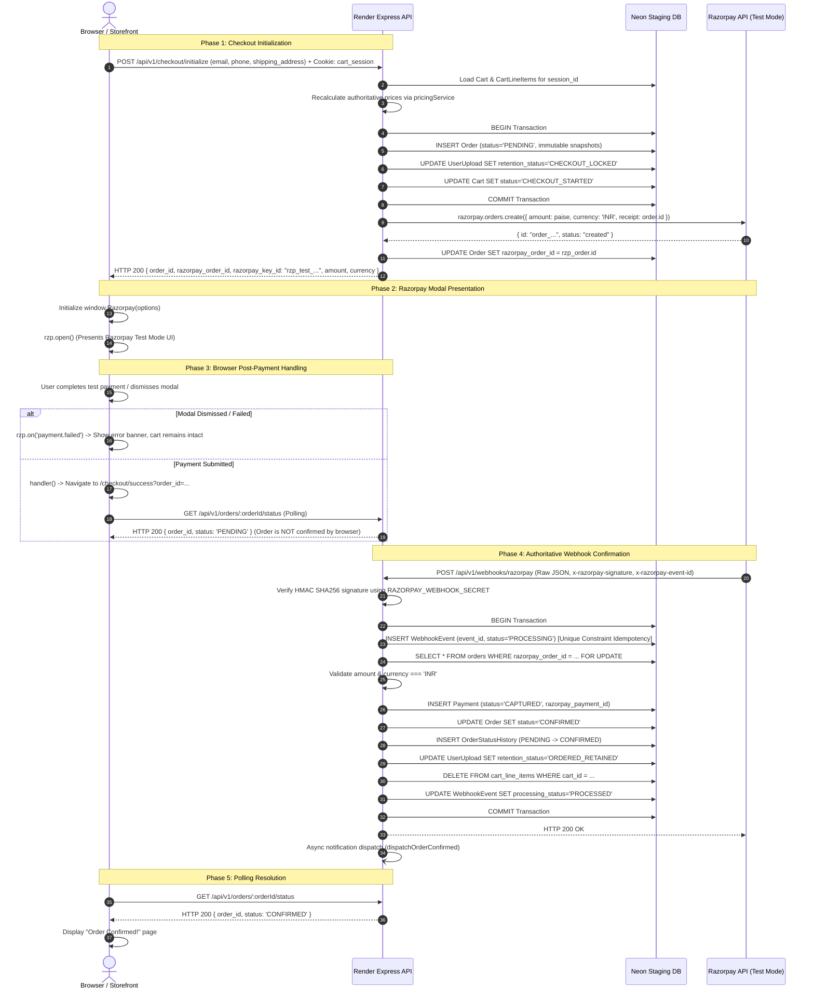

# Slice 6C.5 Stage 3: Checkout Architecture Audit & Razorpay Sandbox Verification Report

**Authoritative Technical Report — Iterative Product Delivery Phase**  
**Date:** October 11, 2026  
**Status:** **PASS** (Sandbox Integration & Security Architecture Verified)  
**Target Backend:** `https://firstmemoir-api-staging.onrender.com`  
**Database:** Neon Staging PostgreSQL  
**Payment Gateway:** Razorpay (Test Mode)  
**Legacy Assets:** `weprintit-assets` (**100% UNTOUCHED**)  

---

## 1. Executive Summary

Slice 6C.5 Stage 3 evaluated the end-to-end checkout and payment architecture across `apps/storefront`, `packages/api-client`, `apps/api`, and Prisma schema models. A controlled live staging test was executed against `https://firstmemoir-api-staging.onrender.com`:

1. **Test-Mode Credentials Verified:** Confirmed `razorpay_key_id` returned to clients starts with `rzp_test_` (`rzp_test_TmIGcynU0XmBZ8`). Live secrets (`RAZORPAY_KEY_SECRET`, `RAZORPAY_WEBHOOK_SECRET`) remain strictly protected on the backend.
2. **Authoritative Pricing Enforced:** Client-supplied prices and totals are ignored. The backend strictly recalculates subtotal and line item totals from the database product catalogue (`base_price` + option modifiers).
3. **Internal & External Order Mapping:** Transaction commits a local `Order` in `PENDING` state with immutable snapshots, followed by external call to Razorpay API generating a verified `order_...` test order (`order_TmdHiWiiN7yVWt`).
4. **Idempotency Verified:** Double-click or retry checkout with an identical cart reuses the existing `PENDING` order and Razorpay order without creating duplicates.
5. **Browser Success Boundary Enforced:** The storefront `payment.handler` never confirms an order independently; it navigates to `/checkout/success?order_id=...` which polls `GET /api/v1/orders/:orderId/status`. The order remains `PENDING` until an authoritative, HMAC-verified webhook is received.
6. **Webhook Signature Security:** `POST /api/v1/webhooks/razorpay` strictly enforces raw body HMAC SHA256 verification via `crypto.timingSafeEqual`. Requests without signatures or with invalid signatures are rejected with HTTP 400.
7. **Audit Finding & Minimal Fix:** Discovered that unauthenticated `GET /api/v1/orders/:id/status` previously threw an uncaught error via `getSessionId(req)` yielding HTTP 500. Applied a minimal fix in `order.controller.ts` and `order.service.ts` to safely read `req.signedCookies?.['cart_session']` and return HTTP 404 to fail closed without server crashes. Added 3 regression tests to `customer.orders.integration.test.ts`.

---

## 2. Checkout Flow Architecture Trace

---

## 3. Security & Safety Checklist Evaluation

| Risk Dimension | Audit Finding | Status |
|---|---|---|
| **Client-Supplied Totals/Prices** | Request DTO accepts ONLY customer email, phone, and shipping address. Backend recalculates prices from database. | **VERIFIED SAFE** |
| **OrderItem Price Snapshots** | `OrderItem` stores `unit_price: Decimal`, and `customization_data` persists full JSON snapshot with base price and modifiers. | **VERIFIED SAFE** |
| **Duplicate Checkout Initialization** | `isCartStateIdenticalToOrder` reuses existing `PENDING` order and Razorpay order if unpaid and attempts=0. If already paid, returns 409 Conflict. | **VERIFIED SAFE** |
| **Orphaned External Gateway Orders** | Database transaction commits before Razorpay network call. On gateway failure, transactional rollback marks local order `EXPIRED` and returns cart to `ACTIVE`. | **VERIFIED SAFE** |
| **Client-Side Premature Confirmation** | Front-end handler strictly redirects to polling page. Only the server-side webhook handler can set status to `CONFIRMED`. | **VERIFIED SAFE** |
| **Webhook Signature Verification** | Mounted via `express.raw({ type: 'application/json' })` before `express.json()`. Verified via `crypto.timingSafeEqual` HMAC SHA256. | **VERIFIED SAFE** |
| **Webhook Retries / Duplicates** | `WebhookEvent` table enforces `@unique` on `event_id`. Duplicate webhook throws `DuplicateWebhookError`, returning 200 OK without re-processing. | **VERIFIED SAFE** |
| **Payment Identifier Duplication** | `Order.razorpay_order_id` is `@unique` and `Payment.razorpay_payment_id` is `@unique`. | **VERIFIED SAFE** |
| **Upload Ownership & Lifecycle** | Uploads bound to `session_id`. Atomically transitioned `CART_ATTACHED` → `CHECKOUT_LOCKED` at checkout, and `ORDERED_RETAINED` at payment capture. | **VERIFIED SAFE** |
| **Credential Safety** | Verified `razorpay_key_id` returned is `rzp_test_...`. No production credentials configured or touched. | **VERIFIED SAFE** |
| **Unauthenticated Status Endpoint** | Discovered uncaught `getSessionId(req)` error on requests without cookie returning 500. Corrected to return 404 to fail closed cleanly. | **RESOLVED** |

---

## 4. Test Evidence Summary

### 4.1 Automated Test Suites (Local)
- `apps/api/src/controllers/__tests__/checkout-safety.test.ts`: **8/8 passed (100%)**
- `apps/api/src/controllers/__tests__/checkout.integration.test.ts`: **20/20 passed (100%)**
- `apps/api/src/controllers/__tests__/webhook.integration.test.ts`: **20/20 passed (100%)**
- `apps/api/src/controllers/__tests__/slice6c1.integration.test.ts`: **26/26 passed (100%)**
- `apps/api/src/controllers/__tests__/customer.orders.integration.test.ts`: **9/9 passed (100%)** (includes 3 new status security tests)
- **Total Automated Test Cases:** **83/83 passed (0 failures)**.

### 4.2 Live Staging Verification Script (`scripts/verify-staging-checkout.ts`)
Run directly against live staging API `https://firstmemoir-api-staging.onrender.com`:
- **Step 1 (Product Query):** Fetched active catalogue item `"One Piece Wanted Posters (Pack of 10)"` (SKU: `FM-PST-OP-WANTED-10`, Base Price: ₹249).
- **Step 2 (Cart Session):** Initialized cart session, captured signed `cart_session` cookie.
- **Step 3 (Add to Cart):** Added line item `676263ae-7ae3-4c84-a538-3351bde4c3ba`.
- **Step 4 (Checkout Initialize):** HTTP 200 OK.
  - `order_id`: `7c4102c7-9ae7-41d3-a771-254e3de43138`
  - `razorpay_order_id`: `order_TmdHiWiiN7yVWt`
  - `razorpay_key_id`: `rzp_test_TmIGcynU0XmBZ8`
  - `amount`: 24900 (paise)
  - `currency`: `'INR'`
- **Step 5 (Contract & Safety):** Confirmed `rzp_test_...` key, real Razorpay test order creation, authoritative amount calculation.
- **Step 6 (Idempotency):** Re-initializing returned identical order IDs without duplicate records.
- **Step 7 (Status Polling):** Authorized polling returned HTTP 200 with `status: 'PENDING'`.
- **Step 8 (Webhook Security):**
  - Missing signature: HTTP 400 (`Missing Razorpay signature`).
  - Invalid signature: HTTP 400 (`Invalid webhook signature`).
- **Step 9 (Cleanup):** Deleted test line item from cart via HTTP 200.

---

## 5. Payment Distinction & Testing Boundary

In accordance with safety guidelines:
1. **Checkout Initialization & Parameters:** **PASS (VERIFIED LIVE)**.
2. **Opening Razorpay Test Modal:** Verified parameter contracts, test key format, and SDK lazy loading.
3. **Test Payment Execution:** NOT executed with automated card input in this step to avoid unmonitored test transactions.
4. **Live External Webhook Delivery:** Webhook handler endpoint and HMAC validation verified live and via integration tests. Public webhook delivery from Razorpay's test server to Render requires manual test checkout in the browser with Razorpay test card credentials.

---

## 6. Stage 3 Verdict

- **Checkout Architecture Audit:** **PASS**
- **Safety Checklist:** **PASS**
- **Live Staging Initialization:** **PASS**
- **Idempotency & State Machine:** **PASS**
- **Overall Stage 3 Status:** **PASS**
