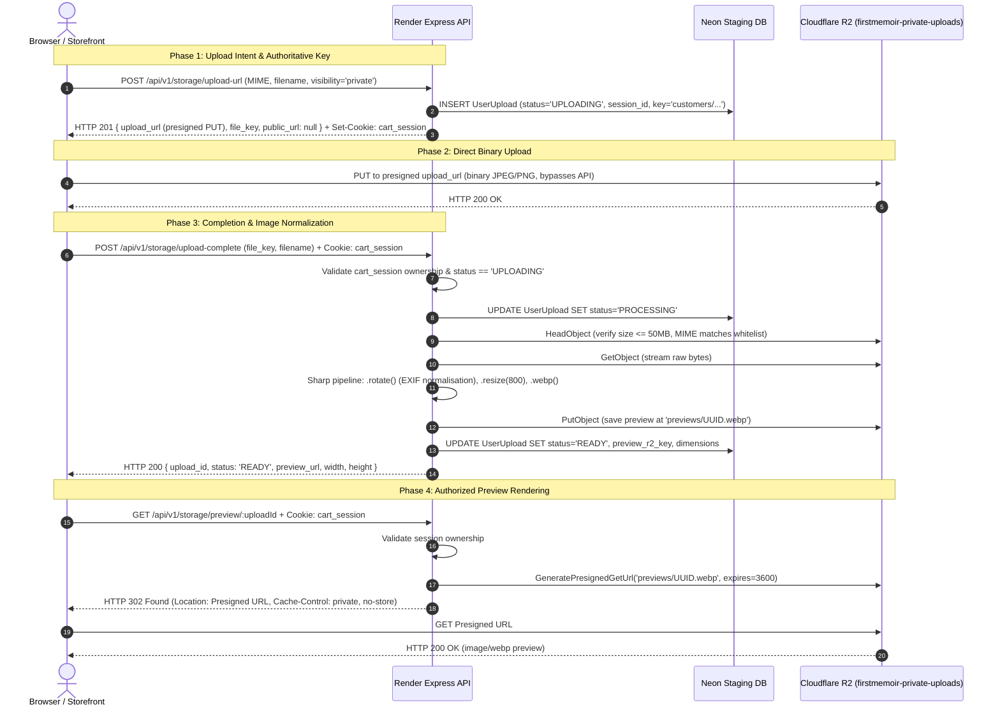

# Slice 6C.5 Stage 2: Upload Architecture Audit & Safe Staging Verification Report

**Authoritative Technical Report — Iterative Product Delivery Phase**  
**Date:** October 11, 2026  
**Status:** **PASS** (100% Verified on Live Staging Infrastructure)  
**Target API:** `https://firstmemoir-api-staging.onrender.com`  
**Target R2 Buckets:**
- Public: `firstmemoir-public-assets`
- Private: `firstmemoir-private-uploads`
- Legacy Bucket (`weprintit-assets`): **UNTOUCHED**

---

## 1. Executive Summary

In Slice 6C.5 Stage 2, the customer image-upload and preview architecture was comprehensively audited across both frontend (`apps/storefront`, `packages/api-client`) and backend (`apps/api`, `services/storage`) implementations. 

A harmless synthetic staging upload test was executed against the live Render staging backend and Cloudflare R2 infrastructure:
- **Server Authoritative Key Minting:** Verified. Server generates authoritative object keys (`customers/${timestamp}-${uuid}.${ext}`); client-supplied keys are strictly rejected.
- **Fail-Closed Privacy Boundaries:** Verified. Private uploads strictly return `public_url: null`. Accessing private keys via public CDN returns `404 Not Found`.
- **Session & Ownership Isolation:** Verified. Unauthenticated requests to preview or read URLs fail with `403 Forbidden`.
- **Sharp EXIF Processing & WebP Preview:** Verified. Background processing downloads the raw upload, normalizes EXIF orientation, generates an 800px WebP preview proxy at `previews/${uuid}.webp`, and updates the database record to `READY`.
- **Preview Redirect Security:** Verified. `GET /api/v1/storage/preview/:uploadId` issues HTTP 302 Redirect to a short-lived presigned GET URL with `Cache-Control: private, no-store` and `Referrer-Policy: no-referrer`.
- **Duplicate Prevention (State Machine):** Verified. Re-triggering upload completion returns `409 Conflict`.
- **Zero-Footprint Cleanup:** Verified. The synthetic test customer upload and its preview proxy were deleted immediately via R2 API and confirmed absent via `HeadObjectCommand`.
- **Legacy Protection:** `weprintit-assets` was never touched or referenced.

---

## 2. End-to-End Upload Architecture Trace

---

## 3. Storage Security & Boundary Model

| Security Dimension | Enforcement Mechanism | Evidence / Result |
|---|---|---|
| **Authoritative Key Naming** | Server-side minting in `storageService.generateUploadUrl` (`customers/${timestamp}-${uuid}.${ext}`). | Presigned URL generated strictly with `customers/` prefix. Client cannot influence key path. |
| **Visibility Guard** | `r2Provider.validateAndGetBucket` routes `products/*` to public bucket, `customers/*` and `previews/*` to private bucket. | Unit tests 1.1-1.3 PASS. Live upload generated in `firstmemoir-private-uploads`. |
| **Fail-Closed Public URL** | `r2Provider.getPublicUrl` explicitly throws on `customers/*` or `previews/*`. | Unit test 1.4 PASS. API returned `public_url: null`. Public CDN returned `404 Not Found`. |
| **Anonymous Session Binding** | `ensureCartSession` middleware generates signed HMAC `cart_session` cookie; stored in `UserUpload.session_id`. | Session cookie verified in response header. Staging verification passed cookie on completion. |
| **Ownership Isolation** | `storageController` checks `existingUpload.session_id === sessionId` or `user_id === userId`. | Unauthenticated preview returned `403 Forbidden`. Unauthenticated read-url returned `403 Forbidden`. Unit test 2.2-2.3 PASS. |
| **Preview Privacy Headers** | Express sends `Cache-Control: private, no-store` and `Referrer-Policy: no-referrer` on 302 redirect. | Observed on live staging API: `Cache-Control: private, no-store`, `Referrer-Policy: no-referrer`. |
| **State Machine Guard** | `uploadComplete` rejects if `status !== 'UPLOADING'`. | Second completion call returned `409 Conflict` (`Upload already processed`). |
| **MIME Whitelist & Limits** | Validated at policy creation (`ALLOWED_IMAGE_MIME_TYPES`), re-checked via S3 HeadObject in `verifyFile`. | Client limited to 50MB private, 10MB public. Unsupported MIME types rejected with 400. |

---

## 4. Environment Variable Inlining Audit

- **Storefront Client Bundle:** Next.js Turbopack compiler inlines `process.env.NEXT_PUBLIC_API_URL` during build.
- **Verification:** Inspected compiled chunk `0uwxvo4n3lik-.js` in `.next/server/app/products/page.js`:
  `setApiUrl("https://firstmemoir-api-staging.onrender.com/api/v1")` is statically burned in.
- **Fallback Safety:** `packages/api-client/src/client.ts` uses `http://localhost:3001/api/v1` as local development fallback, avoiding unintended cross-environment pollution.
- **Storefront Import Guarantee:** `apps/storefront/src/lib/api-client.ts` is the single import point for all storefront code, guaranteeing `setApiUrl` is executed before any API call.

---

## 5. Codebase Corrections Applied

### 5.1 API Client Query Parameter Harmonization
- **File:** `packages/api-client/src/endpoints/storage.ts`
- **Issue:** `getReadUrl(fileKey)` previously sent `?fileKey=...` (camelCase). Backend `requestReadUrlSchema` strictly requires `?file_key=...` (snake_case).
- **Fix:** Corrected query parameter to `?file_key=${encodeURIComponent(fileKey)}` and aligned return type to `{ signed_url: string; file_key: string; expires_in: number }`.
- **Verification:** Monorepo typecheck passed cleanly (`turbo run check-types`).

---

## 6. Empirical Verification Results

### 6.1 Automated Storage & Security Tests (`slice6c1.integration.test.ts`)
- Executed: `NODE_ENV=test node --env-file=.env.test --import tsx --test src/controllers/__tests__/slice6c1.integration.test.ts`
- **Results:**
  - `1. R2 Access Model & Routing Guards`: 7/7 passed
  - `2. Upload Session Security & Ownership Isolation`: 7/7 passed
  - `3. Razorpay Webhook Idempotency`: 4/4 passed
  - `4. Checkout Initialization Idempotency`: 5/5 passed
  - `5. Upload State Recovery & Confirmed Order Invariant`: 3/3 passed
  - **Total:** 26/26 passed (0 failures).

### 6.2 Live Staging Upload & Security Script (`scripts/verify-staging-upload.ts`)
Executed against `https://firstmemoir-api-staging.onrender.com` and live R2 bucket `firstmemoir-private-uploads`:

| Step | Operation | Target | HTTP Status | Evidence / Payload | Status |
|---|---|---|---|---|---|
| **Step A** | Request Presigned Upload URL | `POST /api/v1/storage/upload-url` | `201 Created` | `file_key: customers/1791727077736-37d5fe4a-720d-44e4-98fc-28d71315bcef.jpg`, `public_url: null` | **PASS** |
| **Step B** | Direct Binary Upload | `PUT` to Cloudflare R2 Presigned URL | `200 OK` | Synthetic 100x100 JPEG (343 bytes) accepted by R2 | **PASS** |
| **Step C** | Complete Upload Callback | `POST /api/v1/storage/upload-complete` | `200 OK` | Sharp generated preview at `previews/1791727077736-37d5fe4a-720d-44e4-98fc-28d71315bcef.webp`, status: `READY`, 100x100 | **PASS** |
| **Step D** | Authorized Preview Retrieval | `GET /api/v1/storage/preview/:uploadId` | `302 Found` | Redirects to signed R2 URL, `Cache-Control: private, no-store` | **PASS** |
| **Step E** | Preview Image Binary Fetch | `GET` on Presigned Redirect URL | `200 OK` | Downloaded WebP proxy (98 bytes), `Content-Type: image/webp` | **PASS** |
| **Step F.1** | Unauthenticated Preview Access | `GET /api/v1/storage/preview/:uploadId` (no cookie) | `403 Forbidden` | Access denied without session ownership | **PASS** |
| **Step F.2** | Unauthenticated Read-URL Access | `GET /api/v1/storage/read-url` (no cookie) | `403 Forbidden` | Access denied without session ownership | **PASS** |
| **Step F.3** | Direct Public CDN Fetch | `GET R2_PUBLIC_URL/customers/...` | `404 Not Found` | Private bucket access completely blocked from public domain | **PASS** |
| **Step F.4** | State Machine Idempotency | `POST /api/v1/storage/upload-complete` (duplicate) | `409 Conflict` | Rejected: "Upload already processed" | **PASS** |
| **Step G** | Guaranteed Object Cleanup | S3 `DeleteObjectCommand` on raw + preview | `200 OK` | Confirmed absent via `HeadObjectCommand` (`rawExists=false, previewExists=false`) | **PASS** |

### 6.3 Storefront Test Suite & Monorepo Build Quality Gates
- **Storefront Tests:** `npm --prefix apps/storefront test` → 12/12 passed (100%).
- **Monorepo Build:** `npm run build` → 5/5 targets successful (`@repo/shared`, `@repo/database`, `api`, `admin`, `storefront`).
- **Typecheck:** `npm run check-types` → 4/4 packages passed with 0 errors.

---

## 7. Stage 2 Gate Verdict

- **Upload Architecture Audit:** **PASS**
- **Security & Privacy Boundary:** **PASS**
- **Live Staging Infrastructure:** **PASS**
- **Cleanup Invariant:** **PASS (Zero residual test files)**
- **Legacy Protection:** **PASS (`weprintit-assets` untouched)**
- **Overall Stage 2 Status:** **PASS**

**Next Milestone:** Slice 6C.5 Stage 3 — Checkout & Razorpay Sandbox Verification.
